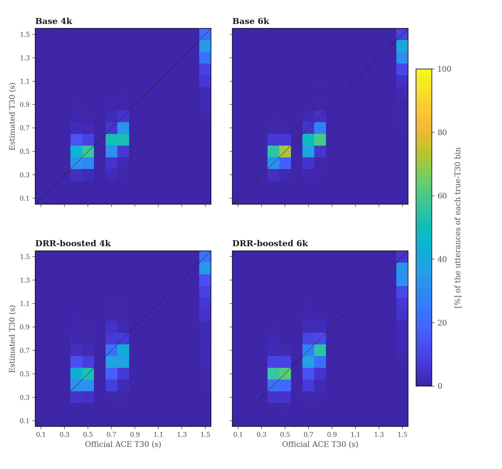

# AWSSDR: blind T30 estimation from speech

AWSSDR estimates room reverberation time (T30) from speech using attention-weighted spectral decay rates. This package labels room impulse responses (RIRs), builds training data and features, trains the model, and averages checkpoints. It includes neither pretrained weights nor a standalone inference command.

[Package source](src/awssdr/) · [Figures](docs/figs/) · [Tests](tests/) · [MIT license](LICENSE)

## Results at a glance

The AWSSDR report (10 November 2026) evaluated four models on 4,500 ACE EVAL utterances against the official FB T30 ISO reference:

| Model | MSE (s²) | Bias (s) | MAE (s) | Pearson ρ |
|---|---:|---:|---:|---:|
| Base 4k | 0.0226 | −0.021 | 0.1072 | 0.935 |
| Base 6k | **0.0196** | −0.029 | **0.1022** | **0.949** |
| DRR-boosted 4k | 0.0312 | −0.020 | 0.1138 | 0.906 |
| DRR-boosted 6k | 0.0271 | −0.024 | 0.1129 | 0.926 |



*ACE EVAL: official T30 on the x-axis, estimated T30 on the y-axis (Figure 5 of the report).*

On real-room recordings, the Base models tracked T30 closely on a free-field microphone but underestimated it on an array microphone and an iPhone. Training with raised direct-to-reverberant-ratio RIRs reduced that bias. All four models failed on VoIP call audio. These are results from the report's trained models, not metrics produced by installing this package.

## Inputs and credits

Training needs external speech (EARS, Google Speech Commands, Qualcomm, ST-AEDS, TIMIT), noise (DEMAND, MS-SNSD), AID transients, and mono 16 kHz RIRs. Corpora and generated datasets are not included; some source licenses limit use to research or non-commercial work. The commands report missing input paths.

The model structure in [`rt_est.py`](src/awssdr/models/rt_est.py) is from S. Kim and H. Kim's AWSSDR code and is included under MIT with their permission. [`acoustic_features.py`](src/awssdr/acoustics/acoustic_features.py) comes from this project's earlier pipeline.

## How to install and use

Use Python 3.13 for the tested dependency versions (minimum Python 3.11):

```bash
python -m pip install -r requirements.txt
python -m pip install -e .
python -m unittest discover -s tests -t .
```

Arrange the external corpora under `<ROOT>/Speech/`, `<ROOT>/Noise/`, and `<ROOT>/Eval_data/AID/wavs/`. Use a separate `<RIR_DIR>` for RIR WAV files. Replace the angle-bracket placeholders with your paths. Run `--dry-run` first; each output directory must be new:

```bash
awssdr-t30-labels --rir-dir <RIR_DIR>
awssdr-utterances --root <ROOT> --rir-dir <RIR_DIR> --out <UTTERANCES> --dry-run
awssdr-utterances --root <ROOT> --rir-dir <RIR_DIR> --out <UTTERANCES> --jobs 4
awssdr-decay-rates --utterances <UTTERANCES> --out <FEATURES> --jobs 4
awssdr-train --train <FEATURES>/v1-6k --dev <DEV_FEATURES> --out <RUN_DIR>
awssdr-average --run <RUN_DIR> --first 90 --last 100
```

`<DEV_FEATURES>` is a prepared development-set feature folder with the same layout as the training features. Optional DRR augmentation and RIR pooling are available through `awssdr-drr` and `awssdr-pool`; use `--help` on any command for its options.
